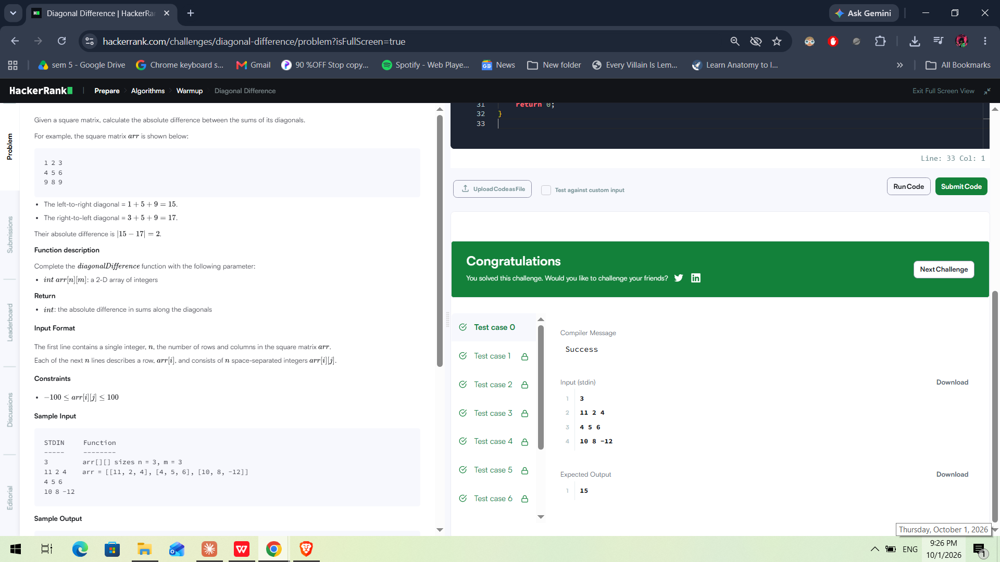
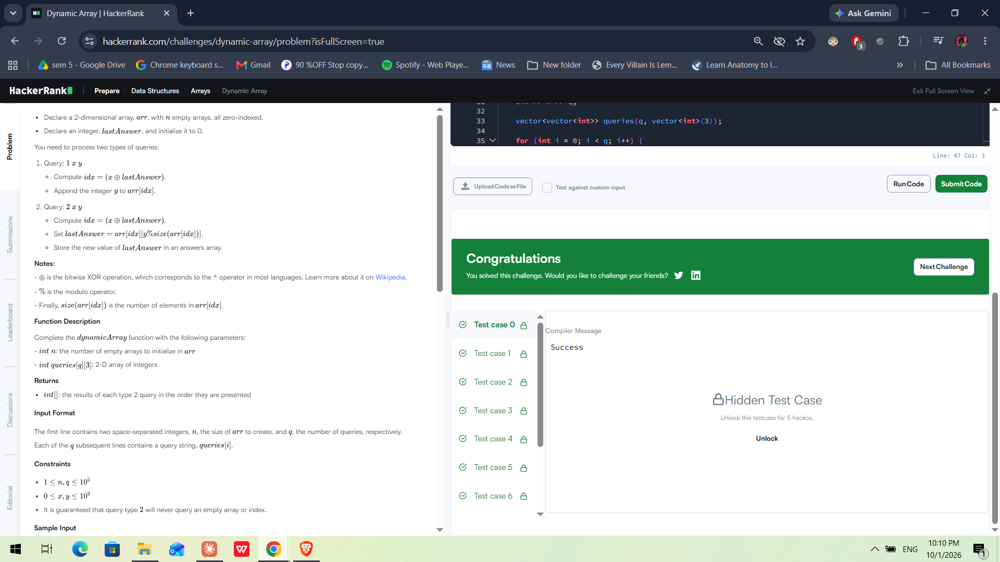
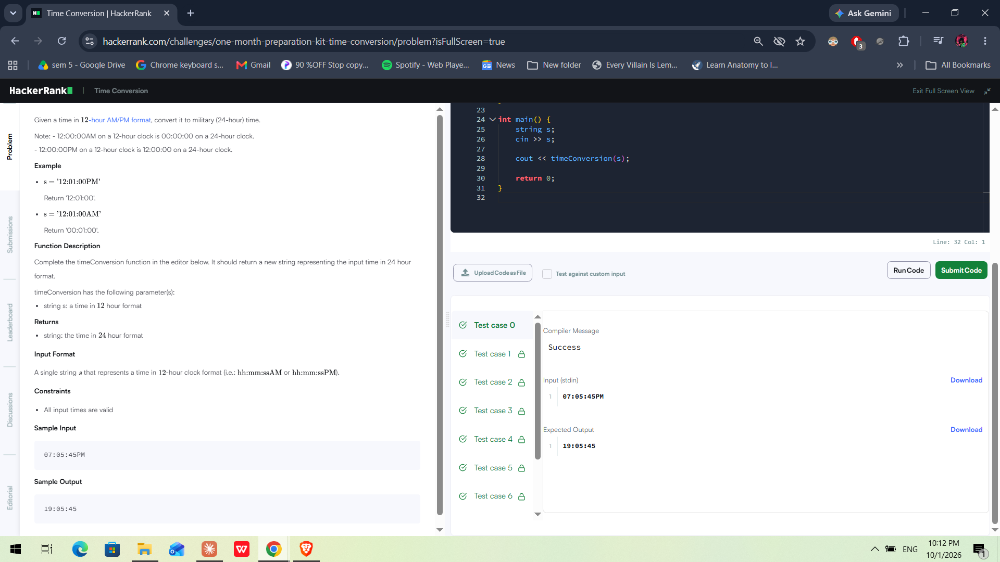
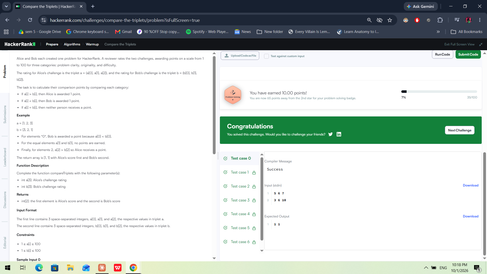
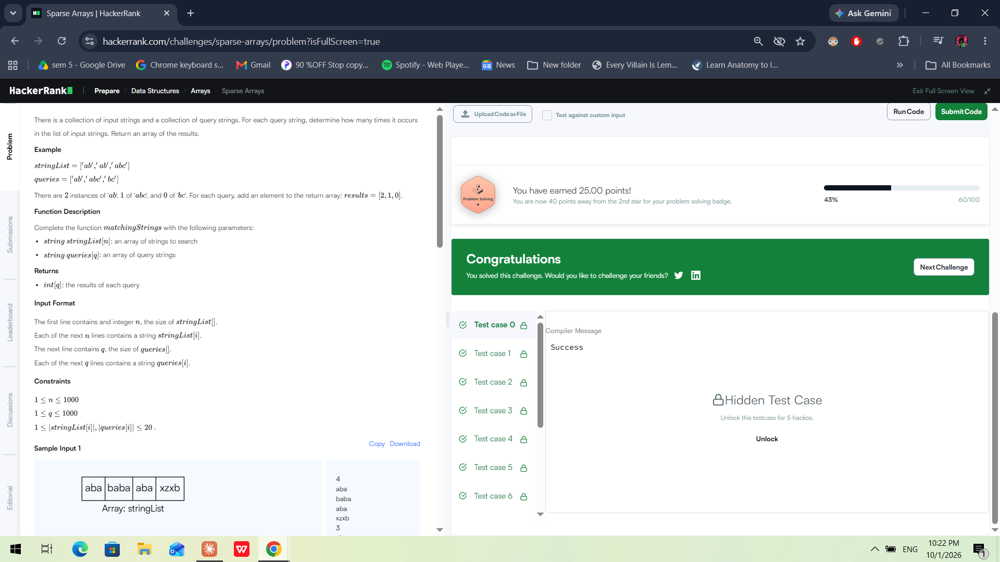

# HackerRank Algorithmic Problem-Solving & Portfolio Integration

**Activity 8 | Portfolio Building (B25CS0311) | 3rd Semester B.Tech (Computer Science & Engineering)**

## About This Activity

In this activity, I solved five mandatory HackerRank problems using **C++20**, analysed the time and space complexity of each solution, and organised the code, accepted-submission screenshots, and documentation in this public GitHub repository. The problems cover matrices, vectors, strings, and hash maps.

## HackerRank Profile

[Visit my HackerRank Profile](https://www.hackerrank.com/profile/sinch73s)

## Repository Structure

```text
HackerRank-3rdSem-Portfolio/
├── Diagonal-Difference/
│   └── solution.cpp
├── Dynamic-Array/
│   └── solution.cpp
├── Time-Conversion/
│   └── solution.cpp
├── Compare-the-Triplets/
│   └── solution.cpp
├── Sparse-Arrays/
│   └── solution.cpp
├── screenshots/
└── README.md
```

Each `solution.cpp` contains the problem name, approach, time and space complexity, and code comments. The files include a small `main()` function so they can compile and run independently. HackerRank submissions use the platform's required function format.

To compile and run an individual solution:

```bash
g++ -std=c++20 solution.cpp -o solution
./solution
```

## Problems Solved

| No. | Problem                                                   | Topic                     | Time Complexity | Space Complexity |
| --: | --------------------------------------------------------- | ------------------------- | --------------- | ---------------- |
|   1 | [Diagonal Difference](Diagonal-Difference/solution.cpp)   | 2D Arrays / Matrices      | O(N)            | O(1)             |
|   2 | [Dynamic Array](Dynamic-Array/solution.cpp)               | Vectors / Data Structures | O(N + Q)        | O(N)             |
|   3 | [Time Conversion](Time-Conversion/solution.cpp)           | Strings & Logic           | O(1)            | O(1)             |
|   4 | [Compare the Triplets](Compare-the-Triplets/solution.cpp) | Basic Implementation      | O(1)            | O(1)             |
|   5 | [Sparse Arrays](Sparse-Arrays/solution.cpp)               | Hash Maps / Strings       | O(N + Q)        | O(N)             |

## 1. Diagonal Difference

**Problem:** Find the absolute difference between the sums of the two diagonals of a square matrix.

**Approach:** Traverse the rows once. Add `arr[i][i]` to the primary diagonal sum and `arr[i][n-1-i]` to the secondary diagonal sum, then return the absolute difference.

**Complexity:** Time — O(N) | Auxiliary space — O(1)

## 2. Dynamic Array

**Problem:** Process type 1 and type 2 queries using `lastAnswer` to determine the target sequence.

**Approach:** Store the sequences in a `vector<vector<int>>`. Calculate `idx = (x ^ lastAnswer) % n`. Type 1 queries append a value; type 2 queries retrieve a value, update `lastAnswer`, and record the answer.

**Complexity:** Time — O(N + Q) | Space — O(N), for the stored sequence elements.

## 3. Time Conversion

**Problem:** Convert a time from 12-hour AM/PM format to 24-hour format.

**Approach:** Change only the hour when needed: `12 AM` becomes `00`, `12 PM` remains `12`, and other PM hours increase by 12. Minutes and seconds remain unchanged.

**Complexity:** Time — O(1) | Auxiliary space — O(1)

## 4. Compare the Triplets

**Problem:** Compare two sets of three ratings and calculate the scores for Alice and Bob.

**Approach:** Compare the three corresponding elements. Award one point to Alice if her value is greater, or to Bob if his value is greater. Equal values award no points.

**Complexity:** Time — O(1) | Auxiliary space — O(1)

## 5. Sparse Arrays

**Problem:** Count how many times each query string appears in a list of strings.

**Approach:** Use an `unordered_map<string, int>` to count each string once while traversing the input. Then answer each query using a map lookup instead of scanning the entire list again.

**Complexity:** Expected time — O(N + Q) | Space — O(N)

## Accepted Submission Screenshots

### Diagonal Difference



### Dynamic Array



### Time Conversion



### Compare the Triplets



### Sparse Arrays



## HackerRank Badge Achievement

**Achievement: 3-Star Problem Solving Badge ⭐⭐⭐**

I earned the 3-Star Problem Solving badge on HackerRank, meeting the badge requirement for this activity.


## Complexity Summary

| Problem              | Time Complexity   | Space Complexity |
| -------------------- | ----------------- | ---------------- |
| Diagonal Difference  | O(N)              | O(1)             |
| Dynamic Array        | O(N + Q)          | O(N)             |
| Time Conversion      | O(1)              | O(1)             |
| Compare the Triplets | O(1)              | O(1)             |
| Sparse Arrays        | Expected O(N + Q) | O(N)             |

**Notation:** N represents the main input size, and Q represents the number of queries. Complexity descriptions follow the intended approaches; hash-map lookup is expected O(1) per operation. For Dynamic Array, the stored elements grow as queries append values, and the answers list can also use O(Q) space.

## Learning Outcomes

* Learning to examine constraints and estimate time and space complexity before coding.
* Using diagonal indices to avoid unnecessary matrix traversal.
* Applying vectors, XOR, and modulo operations to process dynamic queries.
* Using hash maps to reduce repeated string searches.
* Handling edge cases such as `12 AM` and `12 PM`.
* Documenting code, analysing complexity, and organising solutions in a Git repository.
* Practising algorithmic problem-solving and tracking progress through HackerRank achievements.

---

**Course:** Portfolio Building (B25CS0311)
**Activity:** Activity 8 — HackerRank Algorithmic Problem-Solving & Portfolio Integration
**Language:** C++20
